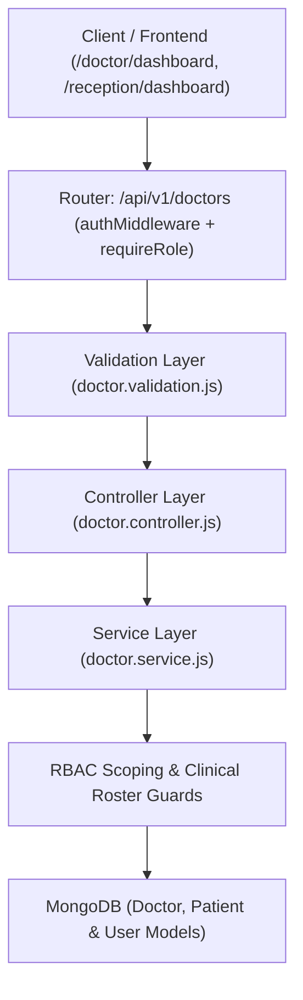

# Doctor Management Module

## Purpose

The **Doctor Management Module** serves as the clinical staff management and care delivery backbone of the **CareOps AI** platform. It establishes clinician profiles linked to authenticated `User` accounts, manages medical specialties, tracks consultation availability schedules, maintains assigned patient queues, and enables recording of clinical follow-up notes.

The module manages:
- Clinician demographic profiles, qualifications, and unique Employee IDs (`DOC-XXXX`).
- Linkage to centralized `User` authentication without duplicate credential storage.
- Real-time consultation availability schedules for appointment booking.
- Patient-to-doctor clinical roster assignments.
- Patient queue tracking for active consultations and follow-up care.
- Role-based privacy safeguards restricting access across operational boundaries.

---

## Architecture

This module follows the CareOps AI standard backend architecture:

```
backend/doctors/
├── doctor.routes.js        # Express router mounted at /api/v1/doctors with RBAC middleware
├── doctor.controller.js    # HTTP request sanitization, response formatting, error mapping
├── doctor.service.js       # Core business logic, user linkage, roster assignment, queue retrieval
├── doctor.validation.js    # Request body schemas, field-level role permission checks
└── README.md               # Module documentation and API specifications
```

### Flow of Execution



---

## Database Schema

### Doctor Profile Model (`backend/models/Doctor.js`)

| Field | Type | Required | Description |
|---|---|---|---|
| `_id` | ObjectId | Auto | Unique MongoDB Document ID |
| `userId` | ObjectId | Yes | Reference to `User` account (`role: DOCTOR`) |
| `employeeId` | String | Unique | Clinician Employee ID (e.g., `DOC-1001`) |
| `name` | String | Yes | Clinician legal name (e.g., `Dr. Rahul`) |
| `email` | String | Yes | Primary contact email |
| `phone` | String | Optional | Contact telephone number |
| `specialization` | String | Yes | Clinical specialty (e.g., `Cardiology`) |
| `department` | String | Yes | Operating department (e.g., `Post-Surgical General & Acute Recovery`) |
| `qualification` | String | Optional | Academic credentials (e.g., `MBBS, MD (Cardiothoracic Care)`) |
| `experience` | Number | Optional | Years of active medical practice (Default: 5) |
| `availability` | Array | Optional | Consultation schedule slots and day blocks |
| `assignedPatients` | Array[ObjectId] | Optional | Roster of active patient IDs (`ref: Patient`) |
| `status` | String | Yes | Employment status: `ACTIVE`, `INACTIVE`, `ON_LEAVE` (Default: `ACTIVE`) |
| `createdAt` | Date | Auto | Audit timestamp |
| `updatedAt` | Date | Auto | Audit timestamp |

### User ⟷ Doctor Relationship

Doctors already exist in the central `User` collection. When an administrator provisions a doctor profile:
1. The service verifies the `userId` exists in `User`.
2. The service enforces that `user.role === "DOCTOR"`.
3. The service prevents duplicate profiles for the same user account.
4. Default demographic fields (`name`, `email`, `phone`, `department`) sync seamlessly between `User` and `Doctor`.

---

## API Documentation

Base Route: `/api/v1/doctors`

### 1. Create Doctor Profile

- **Endpoint**: `POST /api/v1/doctors`
- **Authorization**: `ADMIN` only
- **Request Body**:
```json
{
  "userId": "670c1e8f23908f912b4e87a0",
  "specialization": "Cardiology",
  "department": "Cardiology",
  "qualification": "MBBS, MD",
  "experience": 8,
  "employeeId": "DOC-1001"
}
```
- **Response**: `201 Created`
```json
{
  "success": true,
  "message": "Doctor profile created successfully",
  "doctor": {
    "id": "670c1e8f23908f912b4e87b1",
    "userId": "670c1e8f23908f912b4e87a0",
    "employeeId": "DOC-1001",
    "name": "Dr Rahul",
    "email": "dr.rahul@metrohealth.eco",
    "specialization": "Cardiology",
    "department": "Cardiology",
    "qualification": "MBBS, MD",
    "experience": 8,
    "status": "ACTIVE"
  }
}
```

---

### 2. Get All Doctors

- **Endpoint**: `GET /api/v1/doctors`
- **Authorization**: `ADMIN`, `RECEPTIONIST`, `DEPARTMENT_MANAGER`, `PATIENT`, `DOCTOR`
- **Query Parameters**:
  - `specialization`: Filter by clinical specialty
  - `department`: Filter by hospital department
  - `status`: `ACTIVE`, `INACTIVE`, `ON_LEAVE`
  - `search`: Keyword lookup across name, email, specialty, employeeId
- **Scoping**:
  - `DEPARTMENT_MANAGER`: Only returns doctors within manager's assigned department.
  - `INSURANCE_EMPLOYEE`: Blocked (`403 Forbidden`).
- **Response**: `200 OK`
```json
{
  "success": true,
  "doctors": [
    {
      "id": "670c1e8f23908f912b4e87b1",
      "name": "Dr Rahul",
      "specialization": "Cardiology",
      "department": "Cardiology",
      "status": "ACTIVE"
    }
  ]
}
```

---

### 3. Get Authenticated Doctor Profile

- **Endpoint**: `GET /api/v1/doctors/me`
- **Authorization**: `DOCTOR`, `ADMIN`
- **Purpose**: Allows logged-in clinicians to retrieve their own clinical profile and schedule.
- **Response**: `200 OK`
```json
{
  "success": true,
  "doctor": {
    "id": "670c1e8f23908f912b4e87b1",
    "name": "Dr Rahul",
    "specialization": "Cardiology",
    "department": "Cardiology",
    "experience": 12,
    "status": "ACTIVE"
  }
}
```

---

### 4. Get Doctor Details

- **Endpoint**: `GET /api/v1/doctors/:id`
- **Authorization**: `ADMIN`, `RECEPTIONIST`, `DEPARTMENT_MANAGER`, `DOCTOR`, `PATIENT`
- **Response**: `200 OK`
```json
{
  "success": true,
  "doctor": {
    "id": "670c1e8f23908f912b4e87b1",
    "name": "Dr Rahul",
    "specialization": "Cardiology",
    "department": "Cardiology",
    "qualification": "MBBS, MD",
    "availability": [...]
  }
}
```

---

### 5. Update Doctor Profile

- **Endpoint**: `PATCH /api/v1/doctors/:id`
- **Authorization**:
  - `ADMIN`: Full update authority (including department, status, name).
  - `DOCTOR`: Can update own availability, phone, qualification, specialization. Cannot alter department or status (`400/403`).
- **Request Body**:
```json
{
  "phone": "+1 (555) 749-9999",
  "qualification": "MBBS, MD, FACC"
}
```
- **Response**: `200 OK`
```json
{
  "success": true,
  "message": "Doctor profile updated successfully",
  "doctor": { ... }
}
```

---

### 6. Assign Patient to Doctor

- **Endpoint**: `PATCH /api/v1/doctors/:id/patients`
- **Authorization**: `ADMIN`, `DOCTOR`
- **Request Body**:
```json
{
  "patientId": "670c1e8f23908f912b4e87a5"
}
```
- **Behavior**:
  - Adds patient to `doctor.assignedPatients` (prevents duplicates).
  - Updates patient's `assignedDoctorId` and `assignedDoctorName`.
- **Response**: `200 OK`
```json
{
  "success": true,
  "message": "Patient assigned successfully",
  "doctor": { ... }
}
```

---

### 7. Doctor Patient Queue

- **Endpoint**: `GET /api/v1/doctors/:id/patients`
- **Authorization**: `DOCTOR` (own queue only), `ADMIN`
- **Response**: `200 OK`
```json
{
  "success": true,
  "patients": [
    {
      "id": "670c1e8f23908f912b4e87a5",
      "mrn": "MRN-884920",
      "name": "Rahul Sharma",
      "medicalSummary": "Post-op wound redness & low-grade fever after laparoscopic appendectomy",
      "status": "ACTIVE"
    }
  ]
}
```

---

### 8. Update Consultation Availability

- **Endpoint**: `PATCH /api/v1/doctors/:id/availability`
- **Authorization**: `DOCTOR` (own schedule only), `ADMIN`
- **Request Body**:
```json
{
  "availability": [
    { "day": "Monday", "start": "09:00", "end": "17:00", "slots": ["10:30 AM", "02:00 PM"] },
    { "day": "Wednesday", "start": "10:00", "end": "16:00", "slots": ["11:00 AM", "03:00 PM"] }
  ]
}
```
- **Response**: `200 OK`
```json
{
  "success": true,
  "message": "Availability updated successfully",
  "availability": [ ... ]
}
```

---

### 9. Record Clinical Note

- **Endpoint**: `POST /api/v1/doctors/:id/notes`
- **Authorization**: `DOCTOR` (own profile), `ADMIN`
- **Request Body**:
```json
{
  "patientId": "670c1e8f23908f912b4e87a5",
  "note": "Incision erythema subsided. Discontinue Amoxicillin and begin routine dressing changes."
}
```
- **Behavior**: Appends timestamped clinician note to patient's `medicalSummary` and ensures patient is added to doctor's roster.
- **Response**: `200 OK`
```json
{
  "success": true,
  "message": "Clinical note added successfully",
  "note": "[Dr Rahul - 10/13/2026]: Incision erythema subsided...",
  "patient": { ... }
}
```

---

## Permission Matrix

| Role | View Directory (`GET /`) | View Details (`GET /:id`) | View Own (`GET /me`) | Create Profile (`POST /`) | Update Profile (`PATCH /:id`) | Manage Schedule (`PATCH /:id/availability`) | Assign Patient (`PATCH /:id/patients`) | View Queue (`GET /:id/patients`) | Clinical Notes (`POST /:id/notes`) |
|---|---|---|---|---|---|---|---|---|---|
| **ADMIN** | Yes | Yes | Yes | Yes | Yes | Yes | Yes | Yes | Yes |
| **DOCTOR** | Yes | Yes | Yes | No (403) | Yes (Own) | Yes (Own) | Yes (Own) | Yes (Own) | Yes (Own) |
| **RECEPTIONIST** | Yes | Yes | No (403) | No (403) | No (403) | No (403) | No (403) | No (403) | No (403) |
| **DEPARTMENT_MANAGER** | Yes (Dept) | Yes (Dept) | No (403) | No (403) | No (403) | No (403) | No (403) | No (403) | No (403) |
| **PATIENT** | Yes | Yes | No (403) | No (403) | No (403) | No (403) | No (403) | No (403) | No (403) |
| **INSURANCE_EMPLOYEE** | No (403) | No (403) | No (403) | No (403) | No (403) | No (403) | No (403) | No (403) | No (403) |

---

## Frontend Integration

1. **`src/features/platform/doctors/apiDoctorService.ts`**:
   - Communicates with `/api/v1/doctors`.
   - Transmits JWT Bearer tokens from `localStorage`.
   - Normalizes doctor objects, availability slots, and patient queues.
   - Includes graceful offline fallback for sandbox resilience.

2. **`src/features/platform/mockDoctorService.ts`**:
   - Exports `getDoctors()`, `getDoctorById()`, `getMyDoctorProfile()`, `getAssignedPatients()`, `updateAvailability()`, `assignPatient()`, and `addClinicalNote()`.
   - Delegates operations to `apiDoctorService`.

3. **`src/features/doctor/services/doctorService.ts`**:
   - Connected `getOverview()` to `apiDoctorService.getMyDoctorProfile()`.
   - Connected `getPatientQueue()` to `apiDoctorService.getAssignedPatients()`.

---

## Testing Instructions

Run the integrated automated test suite:

```bash
cd backend
npm test
```

To run only the doctor management suite:

```bash
cd backend
node --test tests/doctors.test.js
```

---

## Future Improvements

- Automated clinician shift scheduling and on-call rotation algorithms.
- Voice-dictated clinical notes transcription engine integration.
- Telemedicine video consultation link dispatching.
