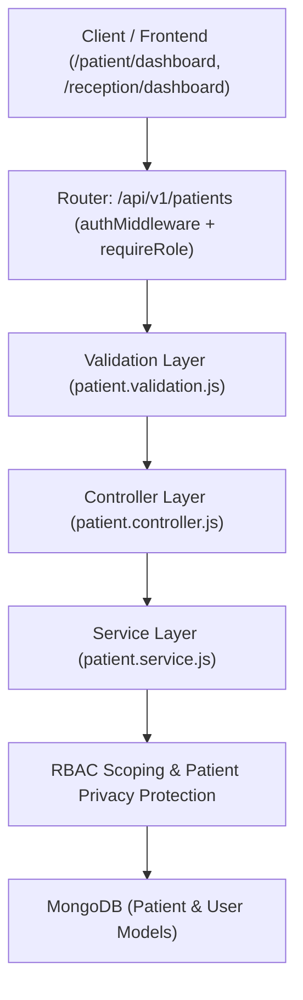

# Patient Management Module

## Purpose

The **Patient Management Module** serves as the core clinical identity and demographic layer of the **CareOps AI** platform. It provides high-reliability, HIPAA-compliant patient management capabilities for hospital administrators, clinicians, front-desk receptionists, department managers, and patients themselves.

The module manages:
- Universal patient demographic indices and unique Medical Record Numbers (MRN).
- Linked `User` account authentication without duplicating credential stores.
- Patient portal profile views and history tracking.
- Role-based privacy safeguards, preventing unauthorized patient data exposure across clinical, operational, and public boundaries.
- Soft deactivation preserving historical longitudinal clinical records.

---

## Architecture

This module adheres to the established CareOps AI enterprise architecture:

```
backend/patients/
├── patient.routes.js        # Express router mounted at /api/v1/patients with RBAC guards
├── patient.controller.js    # HTTP request sanitization, response formatting, error mapping
├── patient.service.js       # Core business logic, role-scoping, user provisioning, soft-delete
├── patient.validation.js    # Request body schemas, field-level role permission checks
└── README.md                # Comprehensive module documentation
```

### Flow of Execution



---

## Database Schema

### Patient Model (`backend/models/Patient.js`)

| Field | Type | Required | Description |
|---|---|---|---|
| `_id` | ObjectId | Auto | Unique MongoDB Document ID |
| `userId` | ObjectId | Optional | Reference to `User` account for authentication |
| `mrn` | String | Unique | Medical Record Number (e.g., `MRN-884920`) |
| `name` | String | Yes | Full patient legal name |
| `email` | String | Yes | Unique contact email (used for User linking) |
| `phone` | String | Yes | Contact phone number |
| `dateOfBirth` | String | Optional | ISO format birthdate (e.g., `1984-06-12`) |
| `gender` | String | Optional | Gender identity (`Male`, `Female`, `Other`, etc.) |
| `address` | String | Optional | Residential address |
| `bloodGroup` | String | Optional | ABO/Rh group (`A+`, `A-`, `B+`, `B-`, `AB+`, `AB-`, `O+`, `O-`) |
| `emergencyContact` | String | Optional | Emergency contact telephone number |
| `medicalSummary` | String | Optional | Clinical summary and ongoing care diagnoses |
| `assignedDoctorId` | ObjectId | Optional | Clinician responsible for primary post-surgical/inpatient care |
| `assignedDoctorName`| String | Optional | Name of assigned clinician (e.g., `Dr. Rahul`) |
| `department` | String | Optional | Operating department (e.g., `Cardiology`, `Endocrinology`) |
| `insuranceProvider` | String | Optional | Primary payer (e.g., `BlueCross Premier PPO`) |
| `insuranceStatus` | String | Optional | Payer status (`Active & Verified`, `Prior-Auth Under Review`) |
| `status` | String | Yes | Account lifecycle state: `ACTIVE`, `INACTIVE` (Default: `ACTIVE`) |
| `createdAt` | Date | Auto | Audit timestamp |
| `updatedAt` | Date | Auto | Audit timestamp |

### Patient ⟷ User Relationship

Patients already authenticate using the CareOps AI centralized User model. When a patient is registered through `/api/v1/patients`:
1. The service checks if a `User` account already exists with that email.
2. If absent, it automatically provisions a new `User` document with role `PATIENT` and an initial temporary password.
3. The new or existing user's ID is stored in `patient.userId`.
4. Authentication tokens map directly to the patient's record during `/api/v1/patients/me` queries.

---

## API Documentation

Base Route: `/api/v1/patients`

### 1. Create Patient

- **Endpoint**: `POST /api/v1/patients`
- **Authorization**: `ADMIN`, `RECEPTIONIST`
- **Request Body**:
```json
{
  "name": "Rahul Sharma",
  "email": "rahul.sharma@hospital.com",
  "phone": "9876543210",
  "dateOfBirth": "1984-06-12",
  "gender": "Male",
  "address": "124 Park Ave, New York, NY",
  "bloodGroup": "O+",
  "emergencyContact": "9876543219",
  "department": "Cardiology",
  "medicalSummary": "Post-op wound redness & low-grade fever after laparoscopic appendectomy"
}
```
- **Response**: `201 Created`
```json
{
  "success": true,
  "message": "Patient created successfully",
  "patient": {
    "id": "670c1e8f23908f912b4e87a1",
    "userId": "670c1e8f23908f912b4e87a0",
    "mrn": "MRN-884920",
    "name": "Rahul Sharma",
    "email": "rahul.sharma@hospital.com",
    "phone": "9876543210",
    "dateOfBirth": "1984-06-12",
    "gender": "Male",
    "address": "124 Park Ave, New York, NY",
    "bloodGroup": "O+",
    "emergencyContact": "9876543219",
    "medicalSummary": "Post-op wound redness & low-grade fever after laparoscopic appendectomy",
    "status": "ACTIVE",
    "createdAt": "2026-10-13T10:15:00.000Z"
  }
}
```

---

### 2. Get All Patients

- **Endpoint**: `GET /api/v1/patients`
- **Authorization**: `ADMIN`, `DOCTOR`, `RECEPTIONIST`, `DEPARTMENT_MANAGER`, `INSURANCE_EMPLOYEE`
- **Query Parameters**:
  - `search`: Filter by Name, Phone, Email, or MRN
  - `gender`: Filter by Gender
  - `bloodGroup`: Filter by Blood Group (e.g. `O+`, `A+`)
  - `status`: `ACTIVE` or `INACTIVE`
  - `department`: Filter by Department
- **Scoping Behaviors**:
  - `DOCTOR`: Only returns patients assigned to the requesting doctor.
  - `DEPARTMENT_MANAGER`: Only returns patients in the manager's assigned department.
  - `PATIENT`: Forbidden (403).
- **Response**: `200 OK`
```json
{
  "success": true,
  "patients": [
    {
      "id": "670c1e8f23908f912b4e87a1",
      "mrn": "MRN-884920",
      "name": "Rahul Sharma",
      "email": "rahul.sharma@hospital.com",
      "phone": "9876543210",
      "bloodGroup": "O+",
      "status": "ACTIVE"
    }
  ]
}
```

---

### 3. Get Authenticated Patient Profile

- **Endpoint**: `GET /api/v1/patients/me`
- **Authorization**: `PATIENT`, `ADMIN`
- **Purpose**: Allows authenticated patients to view their own healthcare records.
- **Response**: `200 OK`
```json
{
  "success": true,
  "patient": {
    "id": "670c1e8f23908f912b4e87a1",
    "mrn": "MRN-884920",
    "name": "Rahul Sharma",
    "email": "rahul.sharma@hospital.com",
    "phone": "9876543210",
    "dateOfBirth": "1984-06-12",
    "gender": "Male",
    "medicalSummary": "Post-op wound redness & low-grade fever after laparoscopic appendectomy",
    "status": "ACTIVE"
  }
}
```

---

### 4. Get Single Patient

- **Endpoint**: `GET /api/v1/patients/:id`
- **Authorization**: Role-scoped
  - `ADMIN`, `RECEPTIONIST`, `INSURANCE_EMPLOYEE`: Full access.
  - `DOCTOR`: Only permitted if assigned to this patient (403 otherwise).
  - `DEPARTMENT_MANAGER`: Only permitted if patient belongs to manager's department (403 otherwise).
  - `PATIENT`: Only permitted if accessing own record (403 otherwise).
- **Response**: `200 OK`
```json
{
  "success": true,
  "patient": {
    "id": "670c1e8f23908f912b4e87a1",
    "mrn": "MRN-884920",
    "name": "Rahul Sharma",
    "email": "rahul.sharma@hospital.com",
    "phone": "9876543210",
    "medicalSummary": "Post-op wound redness & low-grade fever after laparoscopic appendectomy",
    "status": "ACTIVE"
  }
}
```

---

### 5. Update Patient

- **Endpoint**: `PATCH /api/v1/patients/:id`
- **Authorization**:
  - `ADMIN`: Can update any field including `medicalSummary` and `status`.
  - `DOCTOR`: Can update `medicalSummary` for assigned patients.
  - `RECEPTIONIST`: Can update demographic info (`phone`, `address`, `emergencyContact`, `gender`, `bloodGroup`). Cannot update `medicalSummary` or `status` (400/403).
  - `PATIENT`: Can update own basic info (`phone`, `address`, `emergencyContact`). Cannot update `medicalSummary` or `status` (400/403).
- **Request Body**:
```json
{
  "phone": "9876500000",
  "address": "990 Lex Ave, Apt 4B, New York, NY"
}
```
- **Response**: `200 OK`
```json
{
  "success": true,
  "message": "Patient updated successfully",
  "patient": {
    "id": "670c1e8f23908f912b4e87a1",
    "name": "Rahul Sharma",
    "phone": "9876500000",
    "address": "990 Lex Ave, Apt 4B, New York, NY"
  }
}
```

---

### 6. Delete / Deactivate Patient (Soft Delete)

- **Endpoint**: `DELETE /api/v1/patients/:id`
- **Authorization**: `ADMIN` only
- **Behavior**: Sets `status = "INACTIVE"`. Preserves clinical history in the database.
- **Response**: `200 OK`
```json
{
  "success": true,
  "message": "Patient deactivated successfully",
  "patient": {
    "id": "670c1e8f23908f912b4e87a1",
    "status": "INACTIVE"
  }
}
```

---

## Role Permissions Matrix

| Role | View Directory (`GET /`) | View Single (`GET /:id`) | View Own (`GET /me`) | Register (`POST /`) | Update (`PATCH /:id`) | Deactivate (`DELETE /:id`) |
|---|---|---|---|---|---|---|
| **ADMIN** | Yes (All) | Yes (All) | Yes | Yes | Yes (Full) | Yes (Soft Delete) |
| **RECEPTIONIST** | Yes (All) | Yes (All) | No | Yes | Yes (Demographics) | No (403) |
| **DOCTOR** | Yes (Assigned Only) | Yes (Assigned Only) | No | No (403) | Yes (Medical Summary) | No (403) |
| **PATIENT** | No (403) | Yes (Own Record Only) | Yes | No (403) | Yes (Own Basic Info) | No (403) |
| **DEPARTMENT_MANAGER** | Yes (Department Only) | Yes (Department Only) | No | No (403) | No (403) | No (403) |
| **INSURANCE_EMPLOYEE** | Yes (All) | Yes (All) | No | No (403) | No (403) | No (403) |

---

## Frontend Integration

The frontend service contract was preserved while switching from mock data to real API endpoints:

1. **`src/features/platform/patients/apiPatientService.ts`**:
   - Communicates with `/api/v1/patients`.
   - Transmits Bearer tokens stored in `localStorage` (`careops_jwt_token`).
   - Normalizes MongoDB models to frontend interfaces.
   - Includes graceful offline fallback for development and sandbox stability.

2. **`src/features/platform/mockPatientService.ts`**:
   - Re-exports `getPatients()`, `getPatientById()`, `getMyProfile()`, `createPatient()`, `updatePatient()`, and `deletePatient()`.
   - Delegates all operations to `apiPatientService`.

3. **`src/features/patient/services/patientService.ts`**:
   - Automatically calls `apiPatientService.getMyProfile()` during `/patient/dashboard` loading.
   - Populates real patient name, MRN, assigned PCP, and insurance status directly into the Patient Portal.

4. **`src/features/reception/services/receptionService.ts`**:
   - Connected `getPatientDirectory()` and `createPatient()` to `apiPatientService`.
   - Allows front-desk staff to register patients directly into the database.

---

## Setup Instructions

### Environment Variables (`backend/.env`)

```env
PORT=5000
MONGODB_URI=mongodb://127.0.0.1:27017/careops
JWT_SECRET=careops_super_secret_jwt_key_2026_production
JWT_EXPIRES_IN=7d
FRONTEND_URL=http://localhost:3000
```

### Running Locally

```bash
cd backend
npm install
npm run dev # or npm start
```

---

## Testing Instructions

Run the integrated automated test suite:

```bash
cd backend
npm test
```

To run only the patient management suite:

```bash
cd backend
node --test tests/patients.test.js
```

---

## Future Improvements

- Integration with FHIR / HL7 compliant electronic health records.
- Patient biometric and two-factor intake verification.
- Automated insurance eligibility verification webhooks.
